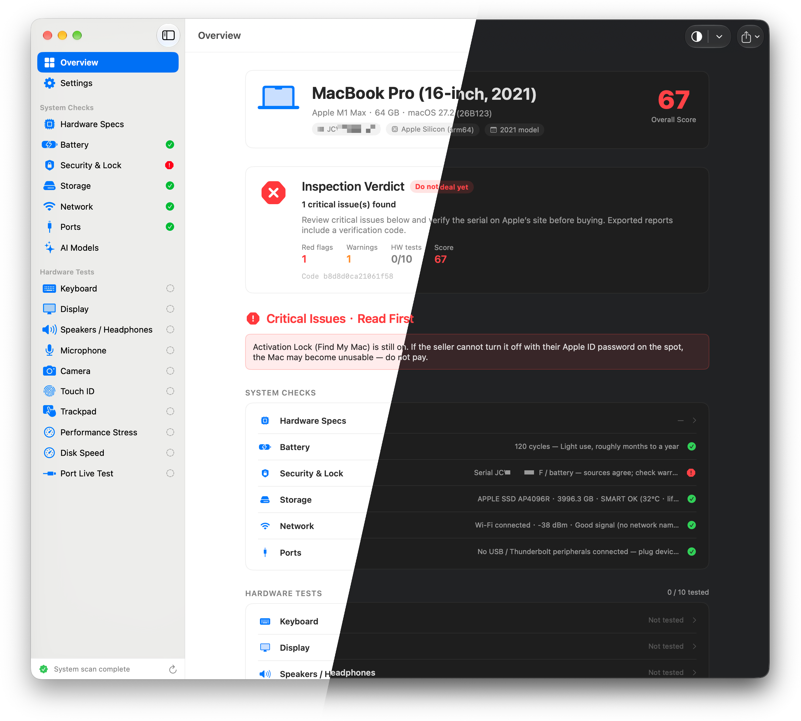
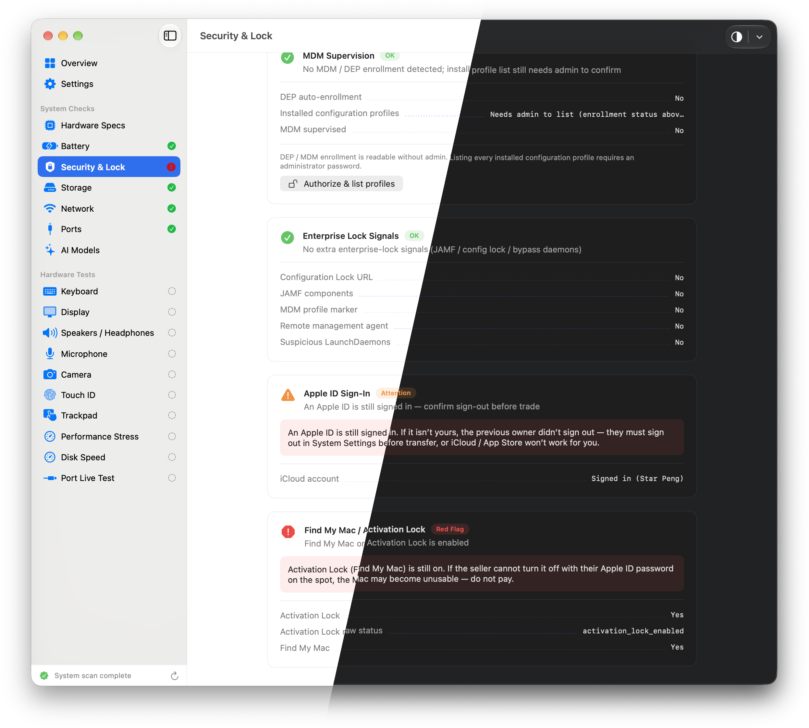

# MacInspect

[English](README.md) · [简体中文](README.zh-Hans.md)

Local macOS inspection tool for used-Mac deals, shop counters, and self-checks. Reads hardware, battery, storage, network, security, and ports; runs interactive tests (keyboard, display, audio, mic, camera, trackpad, disk speed, and more); exports PDF / PNG reports.

Runs fully offline by default — no serial numbers, scan results, or reports are uploaded.

<p align="center">
  
</p>

<p align="center">
  
</p>


## Features

- Model, chip, memory, macOS version, serial, board identity, and specs-library cross-check
- Battery health, storage, network, Bluetooth, and port discovery
- Security & Lock: MDM / DEP, enterprise-lock signals, Apple ID, Find My / Activation Lock, security chip
- Interactive checks: keyboard, display patterns, audio, mic, camera, Touch ID, trackpad
- Disk speed, short performance stress, per-port live checks
- Local LLM fit hints from installed RAM
- PDF / PNG report export; toolbar appearance quick switch (system / light / dark)
- In-app language: English, Simplified Chinese, Traditional Chinese


## Requirements

- macOS 14.0+
- Apple Silicon or Intel
- Xcode 16+ to build from source (`xcodegen` optional if you edit `project.yml`)


## Install

1. Download a DMG from [Releases](https://github.com/starpeng/MacInspect/releases): `-intel`, `-apple-silicon`, or `-universal`.
2. Drag `MacInspect.app` to Applications.
3. If Gatekeeper blocks first launch: right-click → **Open**, or allow under **System Settings → Privacy & Security**.

Signed + notarized builds are preferred for distribution. Ad-hoc DMGs from the scripts are for local testing.

Quarantine false positive (“damaged”):

```bash
sudo xattr -rd com.apple.quarantine /Applications/MacInspect.app
```


## Usage

1. Launch and wait for the overview scan.
2. Review red / high-risk items first.
3. Run hardware tests from the sidebar.
4. Export a PNG or PDF report.


## Build

```bash
git clone https://github.com/starpeng/MacInspect.git
cd MacInspect

./scripts/run.sh                  # Debug build + launch
# or
./scripts/release.sh universal
```

Release builds, signing, and notarization: [docs/BUILD.md](docs/BUILD.md).  
Release checklist: [docs/RELEASE.md](docs/RELEASE.md).  
Manual test list: [docs/TESTING.md](docs/TESTING.md).

Tag a version to publish via GitHub Actions (`v1.3` → notes `docs/RELEASE_NOTES_1.3.md` + three DMGs):

```bash
git tag v1.3 && git push origin v1.3
```

```text
artifacts/dist/MacInspect-<version>-{intel|apple-silicon|universal}.dmg
```

```bash
export MACINSPECT_SIGN_ID="Developer ID Application: Your Name (TEAMID)"
export MACINSPECT_NOTARY_PROFILE="macinspect-notary"
```


## Layout

```text
src/App|Core|Checks|UI|Localization
Resources/Locales/     # en, zh-Hans, zh-Hant JSON
scripts/               # run.sh, release.sh
docs/
```


## Notes

- Assistive checks only — not a substitute for Apple service diagnostics.
- Activation Lock / warranty still need Apple’s servers / site confirmation.
- Keyboard global-hotkey capture needs **Accessibility**; re-sign may require re-granting.


## License

MIT © 2026 Star Peng — see [LICENSE](LICENSE).

**Retention:** forks, modifications, and redistributions (including derivative works) must keep the `LICENSE` file and the Star Peng copyright notice. See also [NOTICE](NOTICE) for third-party attributions.

## Credits

Independently maintained. Inspiration and prototype from open-source [MacCheck](https://github.com/andyhuo520/MacCheck).

Bundled `MacSpecs.json` is a slim identity catalog (identifier / A-number / SoC / board), built mainly from [AppleDB](https://github.com/littlebyteorg/appledb) (MIT) with Apple Silicon board codes cross-checked against the [Asahi Linux device list](https://asahilinux.org/docs/hw/devices/device-list/). Regenerate with `scripts/generate_mac_device_catalog.py`. Details: [NOTICE](NOTICE).

App icon generated with Google Gemini — see [design/README.md](design/README.md) for the prompt.
