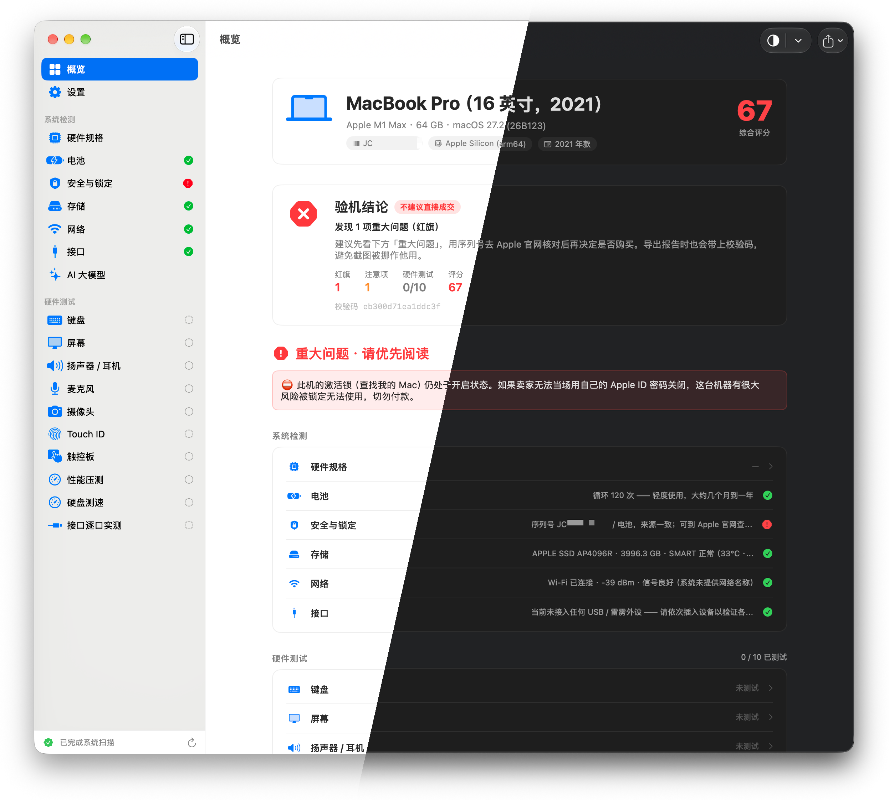
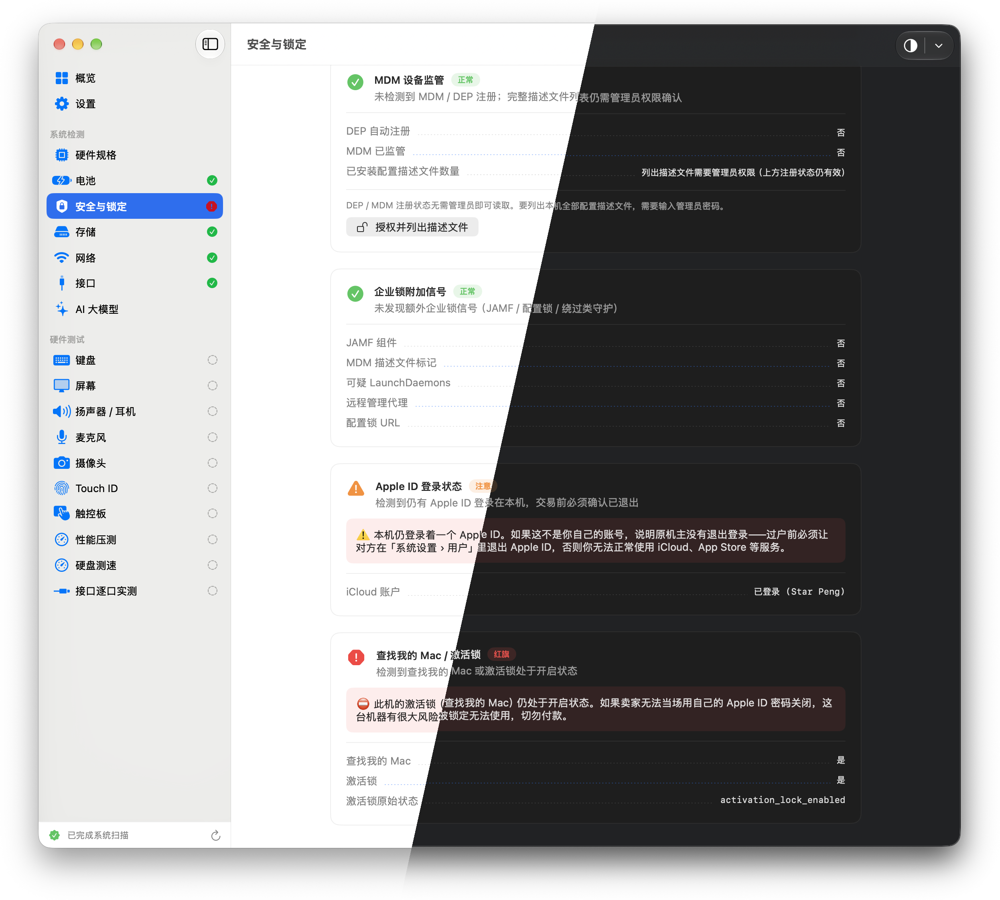

# MacInspect

[English](README.md) · [简体中文](README.zh-Hans.md)

面向二手交易、门店验机与自检的本地 macOS 验机工具。读取硬件、电池、存储、网络、安全与接口信息；提供键盘、屏幕、音频、麦克风、摄像头、触控板、磁盘速度等交互测试；可导出 PDF / PNG 报告。

默认完全离线运行——不上传序列号、扫描结果或报告。

<p align="center">
  
</p>

<p align="center">
  
</p>


## 功能

- 机型、芯片、内存、系统版本、序列号、主板标识与规格库交叉对照
- 电池健康、存储、网络、蓝牙、接口枚举
- 安全与锁定：MDM / DEP、企业锁附加信号、Apple ID、查找我的 Mac / 激活锁、安全芯片
- 交互检测：键盘、屏幕色块、扬声器、麦克风、摄像头、Touch ID、触控板
- 磁盘速度、短时性能压测、逐口插入检测
- 按本机内存给出本地大模型适配参考
- PDF / PNG 报告导出；顶栏外观快捷切换（跟随系统 / 浅色 / 深色）
- 应用内语言：英文、简体中文、繁体中文


## 环境要求

- macOS 14.0+
- Apple Silicon 或 Intel
- 从源码构建需 Xcode 16+（改 `project.yml` 时可选安装 `xcodegen`）


## 安装

1. 从 [Releases](https://github.com/starpeng/MacInspect/releases) 下载 DMG：`-intel`、`-apple-silicon` 或 `-universal`。
2. 将 `MacInspect.app` 拖入「应用程序」。
3. 若首次打开被 Gatekeeper 拦截：右键 → **打开**，或在 **系统设置 → 隐私与安全性** 中允许。

正式分发请优先使用签名 + 公证构建。脚本打出的临时 DMG 仅供本机测试。

误报「已损坏」时可执行：

```bash
sudo xattr -rd com.apple.quarantine /Applications/MacInspect.app
```


## 使用

1. 启动后等待概览扫描完成。
2. 优先查看红色 / 高风险项。
3. 在侧栏运行各项硬件测试。
4. 导出 PNG 或 PDF 报告。


## 构建

```bash
git clone https://github.com/starpeng/MacInspect.git
cd MacInspect

./scripts/run.sh                  # Debug 构建并启动
# 或
./scripts/release.sh universal
```

发布构建、签名与公证：[docs/BUILD.md](docs/BUILD.md)  
发布清单：[docs/RELEASE.md](docs/RELEASE.md)  
手工测试项：[docs/TESTING.md](docs/TESTING.md)

打标签后由 GitHub Actions 发布（例如 `v1.3` → 说明见 `docs/RELEASE_NOTES_1.3.md`，并产出三份 DMG）：

```bash
git tag v1.3 && git push origin v1.3
```

```text
artifacts/dist/MacInspect-<version>-{intel|apple-silicon|universal}.dmg
```

```bash
export MACINSPECT_SIGN_ID="Developer ID Application: Your Name (TEAMID)"
export MACINSPECT_NOTARY_PROFILE="macinspect-notary"
```


## 目录结构

```text
src/App|Core|Checks|UI|Localization
Resources/Locales/     # en、zh-Hans、zh-Hant JSON
scripts/               # run.sh、release.sh
docs/
```


## 说明

- 仅作辅助验机，不能替代 Apple 官方维修诊断。
- 激活锁 / 保修仍需以 Apple 服务器或官网查询为准。
- 键盘全局快捷键拦截需要 **辅助功能** 权限；重新签名后可能需重新授权。


## 许可

MIT © 2026 Star Peng — 见 [LICENSE](LICENSE)。

**保留要求：** fork、修改、再发布（含衍生作品）必须保留 `LICENSE` 文件及 Star Peng 版权声明。第三方归属见 [NOTICE](NOTICE)。

## 致谢

独立维护。灵感与原型来自开源项目 [MacCheck](https://github.com/andyhuo520/MacCheck)。

内置 `MacSpecs.json` 为精简身份对照表（机型标识 / A 编号 / SoC / 主板代号），主要来自 [AppleDB](https://github.com/littlebyteorg/appledb)（MIT），Apple Silicon 主板代号参考 [Asahi Linux device list](https://asahilinux.org/docs/hw/devices/device-list/) 交叉核对。可用 `scripts/generate_mac_device_catalog.py` 重新生成。详见 [NOTICE](NOTICE)。

应用图标由 Google Gemini 生成，提示词见 [design/README.md](design/README.md)。
